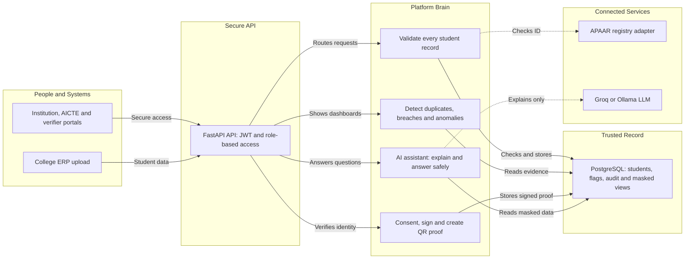
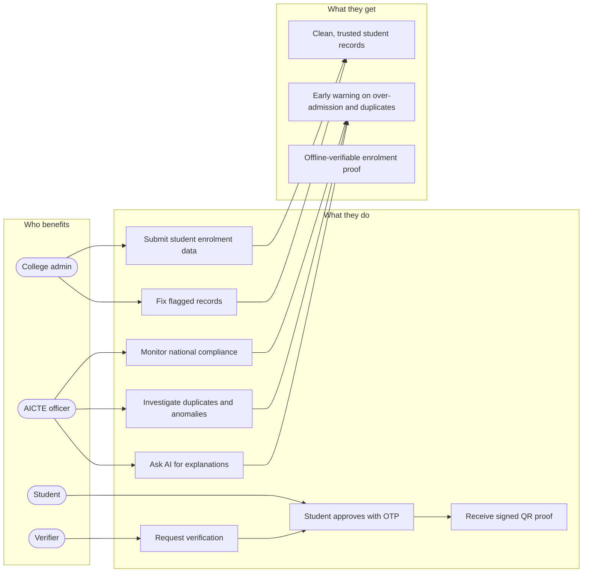
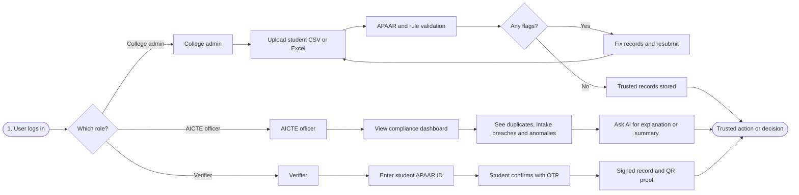
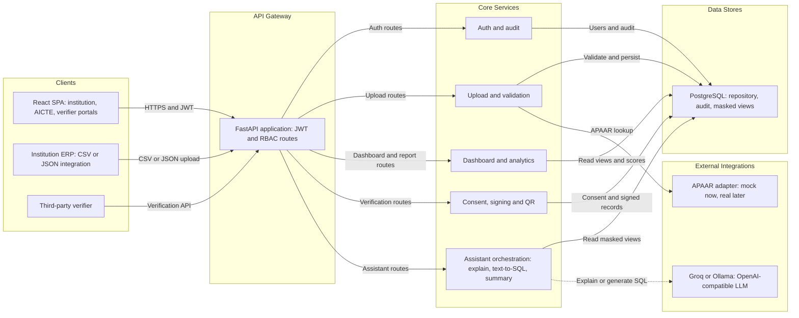
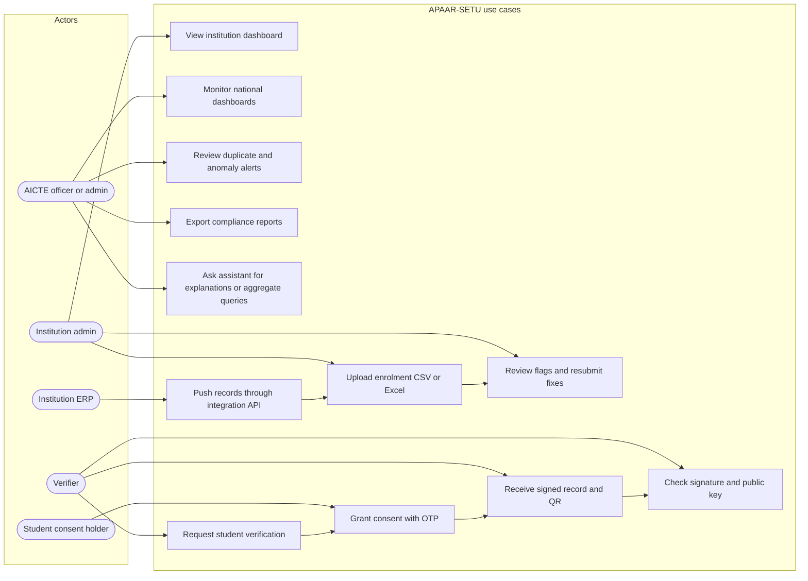

# APAAR-SETU Diagrams

These diagrams are derived from the current repository implementation and documentation.

## Judge-ready versions

Use these simplified views for a presentation: they emphasize the problem, the four user outcomes, and the safety boundary around AI.

### Judge-ready architecture

### Judge-ready use cases

### Judge-ready AI pipeline

```mermaid
flowchart LR
    input(["Student data or officer question"])
    rules["1. Rules decide: APAAR, dates, quota, duplicates and intake"]
    result["Trusted result: valid record or explainable flag"]
    ml["2. ML detects patterns: Isolation Forest and fuzzy matching"]
    risk["Risk signals: anomaly score and duplicate alert"]
    llm["3. LLM explains: masked data and approved views only"]
    guard{"Safe query?"}
    answer["Clear answer: explanation, table or report summary"]
    human(["Human makes the final decision"])
    input --> rules
    rules --> result
    result --> ml
    ml --> risk
    risk --> llm
    input --> llm
    llm --> guard
    guard -->|"Yes"| answer
    guard -->|"No"| answer
    answer --> human
```

### Judge-ready user flow

## 1. Architecture

## 2. Use cases

## 3. AI pipeline

```mermaid
flowchart LR
    start(["Student upload or dashboard question"])
    parse["Parse and normalize rows"]
    rules["Deterministic validation: format, fields, dates, quota, APAAR"]
    registry["APAAR registry lookup"]
    duplicates["Duplicate detection: in-upload, database, fuzzy name plus DOB"]
    aggregates["Aggregate checks: intake and supernumerary limits"]
    persist["Persist accepted rows and flags"]
    features["Build course-year features: 9 analytics features"]
    anomaly["Isolation Forest or Z-score baseline"]
    reasons["Z-score top reasons"]
    dashboard["Dashboard anomaly scores and flags"]
    question["Natural-language assistant question"]
    prompt["LLM prompt with masked views or grouped flags"]
    sql["LLM output: SELECT or explanation"]
    guard{"SQL safe and supported?"}
    reader["Read-only llm_reader: 4 approved views, 5s timeout"]
    summary["LLM summary of computed rows"]
    response["Human-readable explanation, table or summary"]
    reject["Return unsupported or validation error"]

    start --> parse --> rules
    rules --> registry --> duplicates --> aggregates --> persist
    persist --> features --> anomaly --> reasons --> dashboard
    start --> question --> prompt --> sql --> guard
    guard -->|"Yes"| reader --> summary --> response
    guard -->|"No"| reject
    persist -.->|"Grouped rule counts on demand"| prompt
    dashboard -.->|"Computed stats on demand"| prompt
```

## Implementation note

The backend exposes live `/assistant/explain`, `/assistant/query`, and `/assistant/summary` endpoints. The current React `aiAssistantService.ts` is a local deterministic demo response layer and does not call those endpoints yet.
